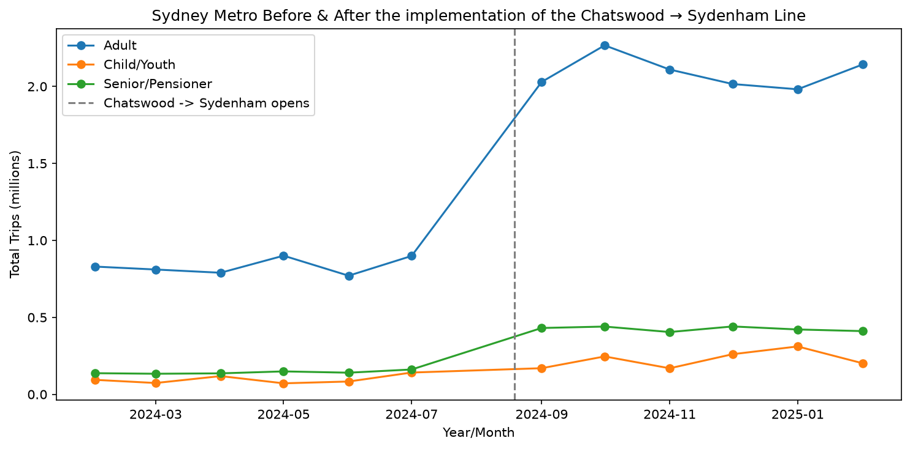

# Sydney Metro City Line: Impact on Sydney Trains Usage

**A data science project analysing Opal trip data to see how the new Chatswood -> Sydenham metro line changed Metro and train usage, and using regression models to predict the effect of the Bankstown metro conversion.**

## Project Overview
This project uses monthly Opal trip counts from Transport for NSW to compare Sydney Metro and Sydney Trains usage before and after the Chatswood -> Sydenham metro line opened on 19 August 2024. The Metro, and the four train lines that cross over with it (T1, T4, T8, T9), are compared for the Adult, Child/Youth, and Senior/Pensioner card types. A Linear Regression and a Decision Tree Regressor are then trained on the four train lines and used to predict trips on the T3 Bankstown Line, which was the next line being converted to metro when this project was created.

## Key findings
* Metro trips for the three card types increased by 155% (6.4M -> 16.5M) after the new line opened, with the Senior/Pensioner card having the biggest percentage increase (+197%) and the Adult card the biggest increase in trips (+7.5M).
* Trips on the four crossover train lines decreased by 15% (69.8M -> 59.1M). The biggest decrease was the Adult card on the T1 North Shore & Western Line (-6.0M, -27%).
* Linear Regression gave the best test result (r2 0.82) after one-hot encoding the card types, but neither model predicted the Bankstown line well (r2 below 0), because the models don't know which line they are predicting and the Sydenham -> Bankstown section closed for the metro conversion on 30th September 2024.

**Tools:** Python, pandas, Matplotlib, NumPy, scikit-learn (Linear Regression, Decision Tree Regressor)

**Data:** Opal trip counts by month, line and card type for Sydney Trains (`train.csv`) and by month and card type for Sydney Metro (`metro.csv`), January 2024 to March 2025. Both files are included in this repository. Source: [Opal Trips – Train and Metro](https://opendata.transport.nsw.gov.au/dataset/opal-trips-train), Transport for NSW Open Data Hub (downloaded 2025), licensed under CC BY.

**How to run:** Put `train.csv` and `metro.csv` in the same folder as `Sydney_Metro_Analysis.ipynb`, install with `pip install numpy pandas matplotlib scikit-learn`, and run all cells.

## Questions

1. How did Sydney Metro usage change after the Chatswood -> Sydenham extension opened, comparing Feb-Jul 2024 (before) with Sep 2024-Feb 2025 (after)?
2. Did the train lines that cross the metro (T1, T4, T8, T9) lose riders, and which lines and card types changed the most?
3. Can trends on those lines predict what happens to the T3 Bankstown Line as it is converted to metro, and whether it would be beneficial for Adult, Child/Youth, and Senior/Pensioner riders?

## Conclusion

Overall through analysis, the addition of the new metro line caused increased usage of the metro, with the Adult card seeing the biggest increase in trips and the Senior/Pensioner card the biggest percentage increase. This increase also reduced usage of the train lines, with Adults having the biggest decrease on the T1 line, while Senior/Pensioners on the T8 line had the biggest increase.

Using this data, predictive models using Linear Regression and Decision Tree Regression were trained to determine if the development of a Bankstown metro extension would be beneficial. Both models predicted the Bankstown line usage would decrease after the metro opened (Linear Regression -15.6%, Decision Tree -17.8%), following the same trend as the other train lines. However, the r2, MAE, and RMSE showed that both models are poorly fitted to the Bankstown data and have high error windows. The actual Bankstown trips dropped 54.8%, as the Sydenham -> Bankstown section closed on 30th September 2024 for the metro conversion, which the models had no way of knowing about.

Based on the trends seen in the metro and train data, the Bankstown metro line would likely be beneficial for Adult, Child/Youth, and Senior/Pensioner riders, as all three card types increased their metro usage after the Chatswood -> Sydenham line opened. The trend on the Bankstown train line would likely follow the same trend seen on the T1, T4, T8 and T9 lines, where train usage decreases with the implementation of a new metro line, with the Adult card seeing the biggest decrease.